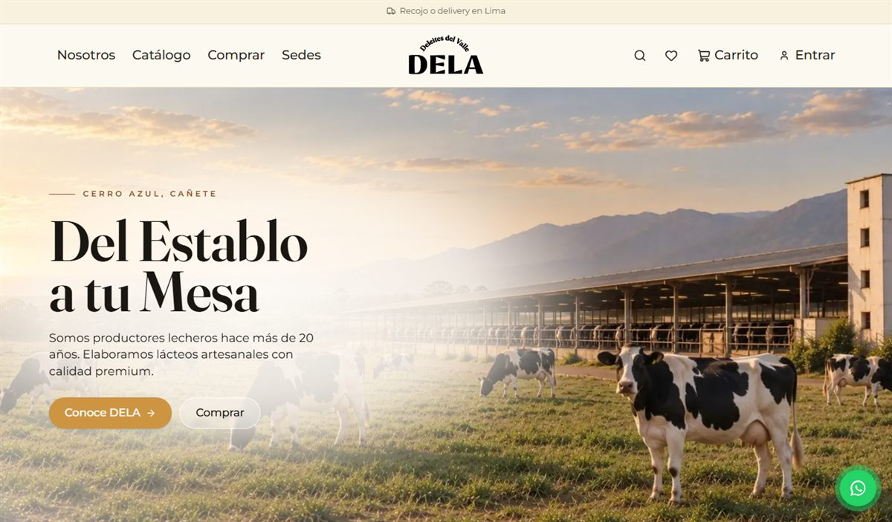
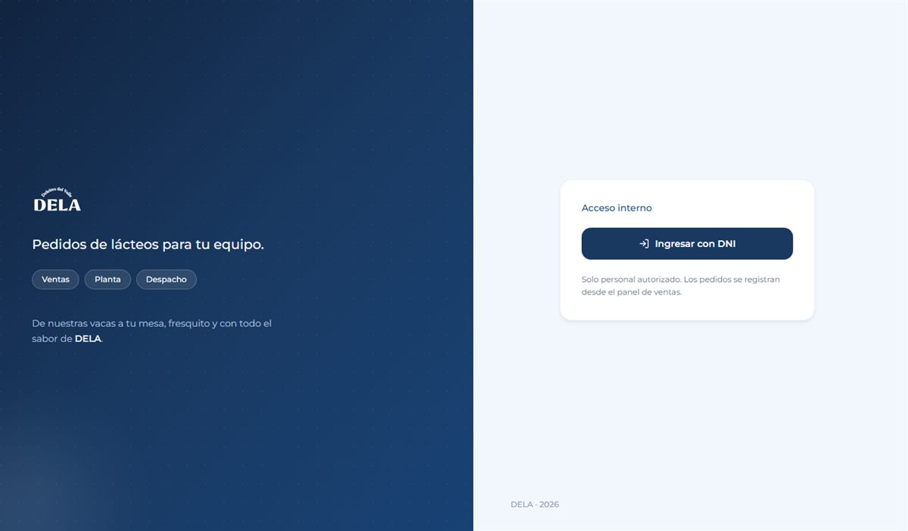
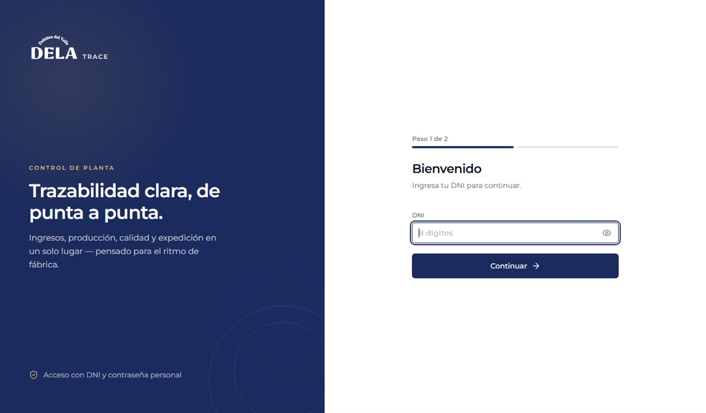
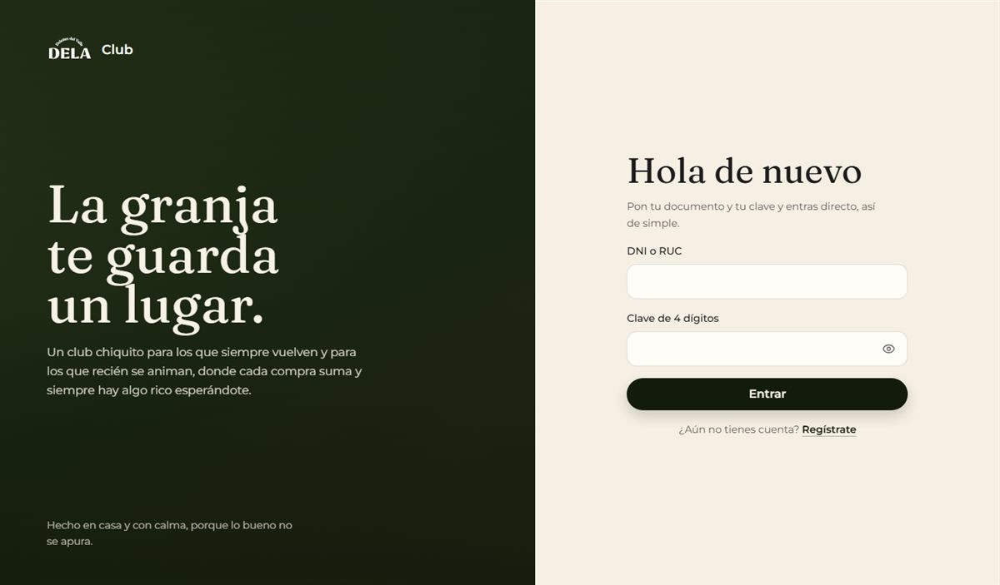
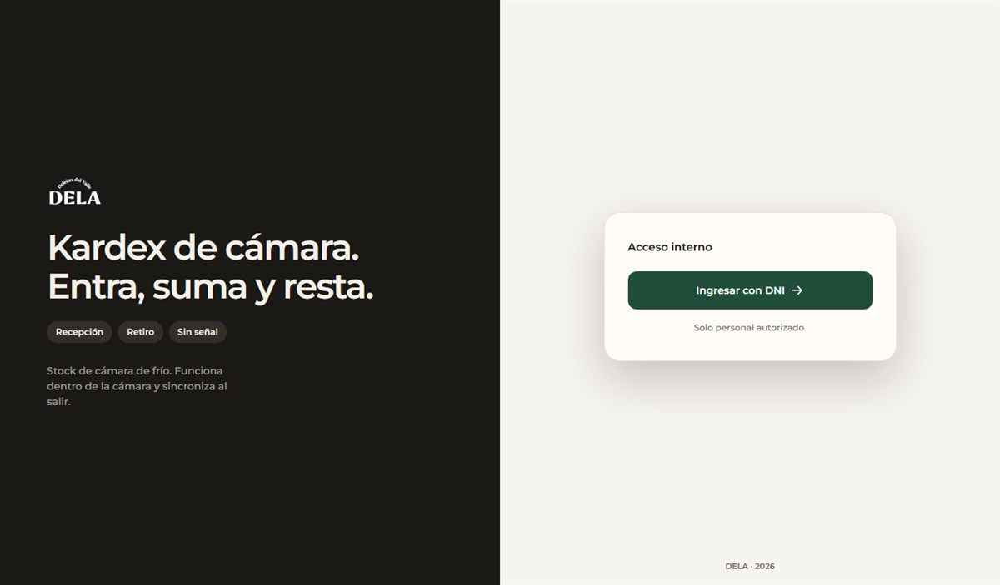

<div align="center">


<a href="https://github.com/AitorCVargas"></a>

<br/>


</div>

<br/>

##  Sobre mí

Soy desarrollador full stack y estudiante de Ingeniería de Sistemas en la Universidad Nacional de Cañete. Me gusta que lo que construyo **se vea bien y funcione mejor**, por eso cuido el diseño de cada pantalla y llevo cada sistema hasta producción.

Como practicante en una empresa de lácteos (abr. – nov. 2026) diseñé y desplegué **cinco sistemas web que hoy usa la operación diaria**, entre ellos una tienda online, pedidos B2B/B2C, trazabilidad de planta, inventario offline y un club de fidelización.

```ts
const aitor = {
  rol: "Full Stack Developer",
  stack: ["TypeScript", "React", "Next.js", "NestJS", "PostgreSQL"],
  fuerte: ["UI cuidada", "APIs REST", "PWAs offline", "Docker"],
  ia: "la uso a diario para acelerar, valido todo con pruebas",
  modalidad: ["Remoto", "Híbrido"],
};
```

<br/>

##  En producción

<table>
<tr>
<td width="50%" valign="top">

<a href="https://dela.com.pe"></a>

### Tienda Online
Comercio electrónico con catálogo, carrito, pagos y panel de administración.


<a href="https://dela.com.pe"></a>

</td>
<td width="50%" valign="top">

<a href="https://b2b.dela.com.pe"></a>

### Pedidos y Logística B2B/B2C
Pedidos, producción y despachos con notificaciones en tiempo real, roles y toma de pedidos asistida por IA.


<a href="https://b2b.dela.com.pe"></a>

</td>
</tr>
<tr>
<td width="50%" valign="top">

<a href="https://trace.dela.com.pe"></a>

### Trazabilidad de Producción
Ingresos, producción, calidad y expedición de una planta de alimentos, con trazabilidad de lotes de punta a punta.


<a href="https://trace.dela.com.pe"></a>

</td>
<td width="50%" valign="top">

<a href="https://club.dela.com.pe"></a>

### Club de Fidelización
PWA con puntos, niveles, misiones, trivia y panel de caja, sincronizada con el sistema de ventas.


<a href="https://club.dela.com.pe"></a>

</td>
</tr>
<tr>
<td width="50%" valign="middle"><a href="https://camarakardex.dela.com.pe"></a></td>
<td width="50%" valign="middle">

### Kardex de Cámara de Frío
PWA que funciona **dentro de la cámara, sin señal**; los movimientos quedan en cola y se sincronizan solos al salir.


<a href="https://camarakardex.dela.com.pe"></a>

</td>
</tr>
</table>

<br/>

##  Tecnologías

<div align="center">

**Lenguajes**<br/>


**Frontend**<br/>


**Backend**<br/>


**Bases de datos**<br/>


**DevOps, escritorio y datos**<br/>


</div>

<br/>

##  Más proyectos

<table>
<tr>
<td width="33%" valign="top">

####  Wasel
Sincroniza Waiterio con Bsale POS para restaurantes, con panel de escritorio y actualizaciones automáticas ([wasel-updates](https://github.com/AitorCVargas/wasel-updates)).

<sub>Node.js · SQLite · WebSocket · Tauri</sub>

</td>
<td width="33%" valign="top">

####  Dashboards de negocio
Ventas, gastos y estado de resultados, recepciones en vivo y avances comerciales, alimentados por la API de Bsale y Excel.

<sub>FastAPI · Python · Docker</sub>

</td>
<td width="33%" valign="top">

####  Portal Ciudadano de Incidencias
Proyecto RSU para la Municipalidad de San Luis, en equipo. Desarrollé el módulo de incidencias con mapas y reportes.

<sub>Next.js · Supabase · Leaflet · Recharts</sub>

</td>
</tr>
<tr>
<td width="33%" valign="top">

####  [Predicción Académica](https://github.com/AitorCVargas/PREDICCION-SISTEMA)
Mi tesis, con machine learning para anticipar el riesgo de bajo rendimiento y activar tutorías a tiempo.

<sub>Python · scikit-learn · XGBoost · Streamlit</sub>

</td>
<td width="33%" valign="top">

####  OdontoSys
Historia clínica odontológica pensada para funcionar en una red local.

<sub>React · Vite · Drizzle · SQLite</sub>

</td>
<td width="33%" valign="top">

####  18 certificaciones
Databricks (Fundamentals y Generative AI) y 16 cursos PIT de la UNI con notas de 17 a 20.

<sub>Datos · Cloud · Ciberseguridad · ML</sub>

</td>
</tr>
</table>

<br/>

<div align="center">

##  Hablemos

¿Buscas a alguien para tu equipo o tienes un proyecto en mente? Escríbeme.

<a href="https://www.linkedin.com/in/aitorcvargas/"></a>
<a href="https://www.instagram.com/aitorcvargas/"></a>
<a href="https://www.facebook.com/AitorCVargas/"></a>


</div>
